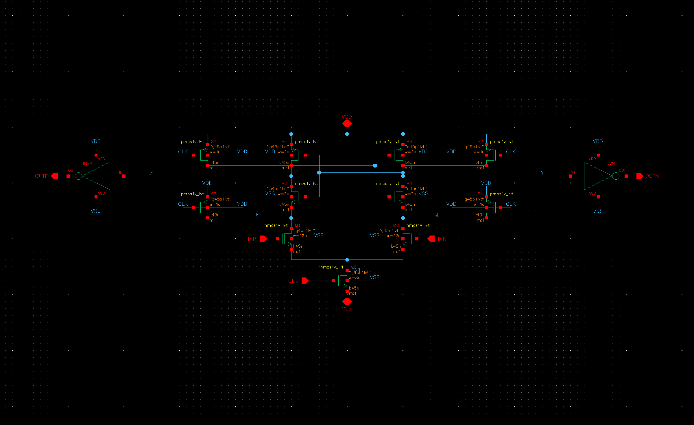

# StrongARM latch, GPDK045, LVT

This is the comparator for the ELEC 5404 mini-project (MLP vs KBNN models of decision delay and energy). The design targets come from a 10-bit, 100 MS/s SAR ADC with VCM-based switching; see `../../PROJECT_PLAN.md`, section 2.

The latch is the modified StrongARM of Razavi ("The StrongARM Latch", IEEE SSC Magazine, Spring 2015, Fig. 1(b)), with all four internal nodes precharged:
- input pair M1/M2
- clocked tail M0
- NMOS latch M3/M4 on the integration nodes P/Q
- PMOS latch M5/M6 on X/Y
- PMOS reset switches S1–S4
- output inverters, each driving a 5 fF load

The output polarity is OUTP = NOT X, so OUTP rises when INP > INN.



| Device | W (total) / fingers | Type |
|---|---|---|
| M1, M2 (input pair) | 12 µm / 4 | nmos1v_lvt |
| M0 (tail) | 8 µm / 4 | nmos1v_lvt |
| M3, M4 (NMOS latch) | 2 µm / 2 | nmos1v_lvt |
| M5, M6 (PMOS latch) | 2 µm / 2 | pmos1v_lvt |
| S1–S4 (reset) | 1 µm / 1 | pmos1v_lvt |
| INV45 (output) | 250 nm N / 700 nm P | LVT |

All devices have L = 45 nm. The sizes live in `skill/sa_sizes.il`.

## Files and flow

Virtuoso library: `SAL45`, in the server's `~/Desktop/StrongArm45`.

```
skill/01_build_latch.il   INV45, STRONGARM, STRONGARM_TB schematics + symbols (PDK callbacks size every device)
skill/02_netlist_tb.il    ADE/OCEAN netlist of STRONGARM_TB -> netlists/sa_tb_ade.scs (layout-aware geometry)
skill/03_screenshots.il   plots/sch_*.png (run with xvfb)
scripts/sa_sim.py         netlist composer, Spectre runner, delay/energy/losing-output measurement, width sweeps
scripts/explore_*.py      design-space explorations (approximate geometry, see below)
scripts/verify_*.py       verification on the real ADE netlist
veriloga/offset_search.va binary-search threshold finder used for offset Monte Carlo
data/                     results (json); raw/ and logs/ stay on the server
```

Steps:
1. Run once from `cadence/`: `common/cf.sh virtuoso latch 01_build_latch`, then `common/cf.sh virtuoso latch 02_netlist_tb`.
2. Copy the ADE netlist into `netlists/sa_tb_ade.scs`.
3. Run the Python scripts from `latch/`. Each script pushes, simulates and pulls through `common/cf.sh`.

**Measurements** (`sa_sim.measure`):
- **t_d:** from the clock crossing 50 % to the first output crossing VDD/2.
- **E:** VDD × supply charge over one full cycle (reset → evaluate → reset).
- **Losing-output peak:** checks for double decisions.

## How the design was reached

The `explore_*` scripts edit widths or model names in the netlist text. They do **not** recompute junction/stress geometry, so they are only good for choosing a direction. Explorations 02–07 ran on the frozen SVT first-cut netlist `netlists/sa_tb_ade_firstcut_svt.scs`; 08–09 ran on the final ADE netlist.

Accuracy of the approximation, for t_d:
- **Larger devices:** about 15 % pessimistic (118 ps in exploration vs 102 ps with real geometry).
- **Larger reset switches:** about 2 % optimistic (103.9 vs 105.8 ps), because their junction capacitance isn't updated.

1. **SVT first cut** (`01_first_look`, `02`): 451 ps at 1 mV and τ = 46 ps.
   - With 4× wider devices it was still 275 ps / 33 ps.
2. **The cause** (`03`) is two separate limits, both near the SVT threshold:
   - **Delay** is the input pair integrating slowly, because VCM = 0.5 V is close to Vth.
     - Raising VCM or using LVT input devices halves it.
   - **τ** is set by the latch devices, which regenerate around VDD/2 = 0.5 V.
     - An LVT latch gives 25 ps, all-LVT gives 14 ps.
   - **Outcome:** switched to LVT throughout.
3. **LVT sizing** (`04`, `05`):
   - The input pair dominates the delay; t_d(1 mV) floors at about 112 ps (approximate geometry) for widths ≥ 8 µm.
   - A 2 µm latch gives the best metastability slack (300 ps − t_d)/τ.
4. **Delay breakdown and output inverter** (`06`, `07`). At 1 mV:
   - X/Y reach a 10 mV split at about 47 ps.
   - Regeneration from 10 to 100 mV takes 33 ps.
   - The inverter adds the rest.
   - **Skewed inverters with a strong PMOS (1.4 µm) are not usable.** During metastability X and Y hover below their trip point, so *both* outputs rise (the losing output reaches 0.5–0.78 V). Measured τ then collapses to under 1 ps at small ΔVin and the log law breaks.
   - With a 700 nm PMOS the law holds down to 1 nV.
5. **Noise vs sizing** (`08`): widening the input pair (16/24 µm) or shrinking the tail (4 µm) left σ_n unchanged within ±7 %. It only cost speed or energy.
6. **Reset switches and decision memory** (`verify_05`, `explore_09`).
   - **Problem:** with the original 250 nm reset switches and a 160 ps reset (SAR-like clock), the latch remembered its last decision. After a +100 mV comparison, a −1 mV input still decided "+". At the next clock edge X/Y were 10 mV apart and P/Q 7 mV apart.
   - **Memory threshold vs reset-switch width,** with 160 / 260 / 360 ps of reset:

     | Reset switch W | 160 ps | 260 ps | 360 ps |
     |---|---|---|---|
     | 250 nm | 3 mV | 100 µV | ≤ 10 µV |
     | 500 nm | 100 µV | ≤ 10 µV | ≤ 10 µV |
     | 1 µm | ≤ 10 µV | ≤ 10 µV | ≤ 10 µV |

   - **Fix:** chose 1 µm. The cost is +3.7 ps t_d(1 mV), +0.5 ps τ and +1.7 fJ.
   - The speed sweeps never exercised reset, which is why 250 nm had looked best.

## Verification (ADE netlist, `verify_*.py`)

### Nominal: 27 °C, VDD 1.0 V, VCM 0.5 V (`verify_01_nominal.py`)

| Quantity | Result | Target |
|---|---|---|
| t_d at ΔVin = 1 mV | 105.8 ps | ≤ 100 ps (proxy; see below) |
| t_d at 300 mV | 46.0 ps | |
| τ (from neighbouring decades, 1 mV → 1 nV) | 9.92–10.00 ps | ≤ ~15 ps |
| Metastability slack (300 ps − t_d(1 mV)) / τ | 19.5 | |
| Energy per comparison | 32.2 fJ | ≤ 50 fJ |
| Losing-output peak | 0.26 V | |
| Symmetry | t_d(−1 mV) = t_d(+1 mV), sign correct | |

The ≤ 100 ps delay target stood in for the metastability requirement (< 10⁻⁶ per conversion at 100 MS/s). With slack 19.5 the metastable window is 1 mV · e^−19.5 ≈ 3 pV, about 3×10⁻⁹ per conversion. So t_d sits 6 % over the proxy while the real requirement is met with a wide margin.

**Solver settings:**
- reltol 1e-6, vabstol 1e-12 V, iabstol 1e-13 A (`sa_sim.TOL`). These match iabstol 1e-15 within 0.002 ps over the whole sweep, and avoid a Newton failure at the clock edge that 1e-15 occasionally caused.
- Medium settings (reltol 1e-5, vabstol 1e-9, iabstol 1e-12) differ by at most 0.2 ps.

### Operating range: t_d(1 mV) / τ in ps, VCM = 0.5 V

| | 0.9 V | 1.0 V | 1.1 V |
|---|---|---|---|
| 0 °C | 132.1 / 18.0 | 101.3 / 9.6 | 86.7 / 5.9 |
| 27 °C | 136.9 / 17.9 | 105.8 / 10.0 | 90.5 / 6.4 |
| 85 °C | 150.5 / 18.6 | 118.0 / 11.1 | 101.2 / 7.5 |

**VCM effect** (27 °C, 1.0 V):

| VCM | t_d(1 mV) | τ |
|---|---|---|
| 0.4 V | 214 ps | 14.1 ps |
| 0.6 V | 82 ps | 9.3 ps |

τ depends on VCM because the input pair still carries the latch current during regeneration.

Energy over the whole range is 24–42 fJ.

Slack is 8.1 at the worst point (0.9 V, 85 °C, VCM 0.5) versus 19.5 nominal. At 100 MS/s the metastability rate goes from about 3e-9 to about 3e-4 per conversion.

### Offset (`verify_02_offset.py`)

**Method:**
- 200-sample Monte Carlo with `variations=mismatch` (GPDK045 `section=mc`).
- In each sample, `offset_search.va` binary-searches ΔVin over 13 clock cycles, to 4 µV resolution.

**Result:** **σ = 2.23 mV** (95 % interval 2.03–2.48 mV), mean −0.32 mV, range −6.6 … +5.6 mV. The target is ≤ 5 mV. With 250 nm reset switches it was 2.27 mV.

**Hand check:** the PDK's LVT mismatch is σ(Vt) = 1.78 mV·µm × 0.689 / √(WL) per device. For the 12 µm × 45 nm pair that gives 2.36 mV, so the input pair dominates.

### Noise (`verify_03_noise.py`, `explore_08_noise.py`)

**Method:** Spectre transient noise with ΔVin held fixed and 300–400 clock cycles per point. P(+) is fitted to Φ(ΔVin/σ).

**Result:**
- **Final design:** **σ_n = 0.58 mV rms** at 100 GHz noise bandwidth (95 % interval 0.53–0.65 mV), from 2400 decisions.
- **With 250 nm reset switches:** 0.60 mV (0.55–0.66 mV) pooled over 3300 decisions.
- **At 200 GHz:** 0.65 mV (0.51–0.89 mV), consistent within error.

**Target:** ≤ 0.65 mV, **met**. It was relaxed from 0.5 mV on 2026-10-30; see `PROJECT_PLAN.md`, section 2.

### Kickback onto a capacitive DAC (`verify_04_kickback.py`)

**Setup:**
- The ideal input sources are replaced by a floating capacitor C_DAC per side, standing in for the CDAC top plate during conversion.
- The capacitors are precharged to VCM ± ΔVin/2 by an initial condition.
- Three back-to-back comparisons per run.

**Results** (final design; residuals measured just before the next comparison's clock edge):

| C_DAC | CM kick | Differential kick before the decision, at ΔVin = 1 mV / 100 mV | t_d(1 mV) (ideal source 105.8 ps) | Residual differential error, ΔVin = 100 mV (0.8 / 0.2 ns reset) |
|---|---|---|---|---|
| 100 fF | −33.7 mV | +2.93 / −10.1 mV | 120.0 ps | −108 / −412 µV |
| 300 fF | −11.9 mV | +0.93 / −3.69 mV | 110.2 ps | −37 / −140 µV |
| 1 pF | −3.6 mV | +0.27 / −1.14 mV | 107.0 ps | −11 / −42 µV |

At ΔVin = 1 mV the residuals are 0.2–5 µV.

**Interpretation:**
- **Common-mode kickback** is a fixed charge of about 3.6 fC, so it scales as 1/C_DAC. It comes from P/Q and the tail falling at the start of evaluation, through the input pair's gate capacitance.
- **Differential kickback** is odd in ΔVin, so it is zero at the threshold. It adds no offset and cannot flip a decision: at 1 mV it adds to the input, at 100 mV it subtracts about 3.7 %.
- **Delay:** the CM drop lowers the input pair's overdrive, so the delay grows by 4 % at 300 fF and 13 % at 100 fF. The ANN dataset uses ideal sources, so its t_d is the stiff-input delay.
- **Residual at the next comparison:**
  - It is proportional to the input: about −0.04 % with the 0.8 ns reset and −0.14 % with the 0.2 ns reset, at 300 fF. That is a small gain error, not an offset; near the threshold it is µV.
  - It appears after the first comparison and then stays constant, so it doesn't accumulate.
  - **Cause:** the tail node rests at about 0.50 V before the first comparison (the input pair charges it in subthreshold). Each reset only restores it to about 0.33 V, which changes the input pair's gate charge on the floating inputs.
- **Effect on the dataset:** comparisons after the first one start from the lower tail voltage and come out 0.7–0.9 ps faster at 1 mV (< 1 %). The dataset uses single comparisons from rest.
- **Recommendation:** C_DAC ≥ 300 fF per side, which a 10-bit design needs anyway for kT/C and matching.

### Decision memory (`verify_05_memory.py`)

**Setup:** an ideal differential input alternates each cycle between +100 mV and −δ, switching in the middle of the reset phase. A −δ cycle that decides "+" shows memory of the previous decision.

**Results** (final design, 1 µm reset switches):

| Reset time | Result |
|---|---|
| 0.8 ns | memory-free down to δ = 1 µV |
| 0.2 ns (160 ps flat) | memory-free down to δ = 1 µV; X/Y back to 1.0000 V at the next edge |
| 0.13 ns (90 ps flat) | memory between 100 and 300 µV (stress case beyond the SAR budget) |

## Spectre notes

- **Multiple `options` statements do not apply per analysis.** reltol, vabstol and iabstol are global and the last value wins (warnings SFE-1131/884). Use one netlist per tolerance set. `alter` statements do apply in sequence.
- **Nested `sweep` blocks:** each closing brace must be on its own line.
- **Monte Carlo mismatch:** GPDK045 mismatch is per instance through `rn1_*`/`rn2_*` in `stat_mis_*`. It is active with `section=mc` and `montecarlo variations=mismatch`.
- **Output size:** transient-noise and Monte Carlo runs at full time resolution are large (2.2 GB for `08`). Future long runs should save only strobe points. `cf.sh spectre` now pulls only the run it just did.

## Dataset

Generated 2026-10-30 (`scripts/gen_dataset.py`, meter `veriloga/sa_meter.va`): 4906 one-comparison transients in `data/dataset/`. Sets, columns and checks are in `data/dataset/README.md`.

## Still to do

- TikZ figure of the schematic for the report.
